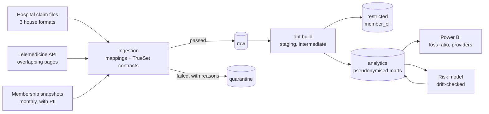

# health-claims-platform

A data platform for a health insurer that runs a network of partner hospitals, clinics and a telemedicine service. It ingests claims from hospitals that each send data their own way, models it into tested, reusable tables, keeps member personal data away from people who do not need it, and ranks claims for review with a model whose inputs are checked for drift before every run.

Everything runs locally on DuckDB in about 20 seconds. The production target is AWS (S3, Glue, Athena, Lake Formation), described in Terraform. All data is synthetic, generated from a seed.

```bash
pip install -e ".[dev]"
claims all          # generate -> ingest -> dbt build -> train -> score -> lineage
pytest -q           # 52 tests; builds the whole platform in a temp directory
make impact M=stg_claims
```



## The problem it is built around

| Source | How it arrives | What goes wrong |
|---|---|---|
| Hospital claims | 299 monthly CSV files from 15 providers | Three house formats: ISO dates, `dd/mm/yyyy` or `yyyymmdd`; amounts as `12345.00`, `"N12,345.00"` or integer kobo; status as words or single letters; ICD-10 codes like `k 3580` for `K35.80`. Rejected claims come back as resubmissions under the same reference. Some rows are broken. |
| Telemedicine | Paginated JSON API | Pages overlap, so 40 consultations arrive twice. Timestamps carry a +01:00 offset. |
| Membership | Monthly JSONL snapshots from the core system | Members change plan or leave between snapshots. Names, phone numbers and dates of birth are included. |

## Ingestion (`src/claims/ingest`)

- **One mapping file per hospital format** (`sources/mappings/*.yaml`) turns every file into the same standard shape. A new hospital on an existing format is a row in the providers seed, not new code. A file whose columns do not match its declared format is rejected whole instead of being misread.
- **Data contracts per source**, run with [TrueSet](https://github.com/trueset-dev/trueset): member ID format, non-negative amounts, valid ICD-10 codes, known statuses, a service date before the submission date. Failing rows go to `lake/quarantine/` with their reasons, so they can be sent back to the hospital. On the synthetic data, exactly the 40 broken rows are quarantined and nothing else (there is a test for it).
- **Idempotent by content.** Every file's SHA-256 goes into a manifest. Re-running skips everything already loaded. A hospital re-sending a corrected file creates a new batch, and staging keeps the latest delivery of each claim, so nothing is double counted.
- **Doctor names are not ingested**: the warehouse does not need them.

## Modelling (`transform/`, dbt)

18 models, 49 data tests, 2 unit tests, 4 reference seeds, 3 exposures.

| Layer | Models |
|---|---|
| staging | typed, de-duplicated sources |
| intermediate | `int_claims_latest` (latest resubmission wins), `int_member_plan_history` (SCD Type 2 from snapshots), `int_claims_orphaned` (claims for members the insurer has never heard of, kept for follow-up instead of dropped) |
| restricted | `member_pii`: the only table that links a member key back to a person |
| analytics | `fct_claims`, `fct_consultations`, `dim_member`, `dim_provider`, `dim_plan`, `dim_employer`, `dim_diagnosis`, `mart_member_months`, `mart_loss_ratio`, `mart_provider_utilisation` |

- **Pseudonymised analytics.** Members appear in analytics only as a salted SHA-256 key. Age is banded. A singular test fails the build if any column in the analytics schema looks like personal data, and another test proves that check really does fail when someone adds one.
- **Contracts on the tables dashboards depend on.** `fct_claims` and `mart_loss_ratio` have enforced column names and types. A change that would break a Power BI report fails in CI, not in a meeting.
- **Cost-aware incremental build.** `fct_claims` reprocesses only the last 60 days of submissions, because corrected resubmissions arrive up to about 50 days late and must replace the original rather than add to it. `on_schema_change='fail'` means a schema change needs a deliberate `--full-refresh`.
- **Reconciliation.** A test checks that every naira of approved, in-cover claims lands in the loss-ratio mart.
- **Row-level lineage.** Every claim in `fct_claims` carries the hospital file and ingestion batch it came from.

On the synthetic data the overall loss ratio is 0.73, ranging from 0.39 to 1.94 by employer: the spread that drives corporate renewal pricing.

## Lineage and code review

`docs/lineage.md` is generated from dbt's manifest. For review, `make impact M=<model>` lists everything downstream, dashboards and the model included:

```
$ make impact M=int_member_plan_history
analytics     fct_claims
analytics     mart_loss_ratio
analytics     mart_member_months
analytics     mart_provider_utilisation
exposure      claim_risk_model
exposure      employer_loss_ratio_report
exposure      provider_performance_report
```

The pull-request template asks for that output, and `CODEOWNERS` requires review on access control and anything touching personal data.

## Claim risk scoring (`src/claims/ml`)

Known patterns are rules; unusual ones are left to a model. Two rules (service outside cover, same visit billed twice) lift a claim to the top. An isolation forest on six features from the analytics schema orders everything else. The model never reads personal data.

The synthetic data hides 179 labelled suspicious claims among 7,518 (a 2.4% base rate). Labels are used only to measure the ranking, never to train:

| Ranking | Precision in the top 179 | Lift | Outside cover | Duplicate billing | Visit frequency | Upcoding |
|---|---|---|---|---|---|---|
| Rules + model | **69.8%** | 29x | 100% | 98% | 100% | 78% |
| Model only | 64.2% | 27x | 52% | 98% | 100% | 78% |

*Recall columns count claims found within the top 2 x 179.*

- **Versioned registry.** Each model is saved under a version derived from its training data and parameters, with its metrics, feature list and a drift reference. Retraining on the same data gives the same version.
- **Drift gate.** Before scoring, the population stability index is computed for every feature against the training data. Above 0.25 the scoring job refuses to run, and the Airflow task fails without retrying, because drift is not transient.

## Access control on AWS (`infra/terraform`)

| Role | Can | Cannot |
|---|---|---|
| ingest | read landing, write raw and quarantine | read or write analytics |
| transform | read every zone, write staging, restricted, analytics | write or delete raw: the record of what sources sent is immutable |
| analyst | read analytics through the analysts Athena workgroup | touch landing, raw, quarantine, staging or restricted (explicit deny), use the sensitive KMS key, query outside the workgroup |
| ml | read analytics, write models and scores | read any personal data |

- Two KMS keys: sensitive (landing, raw, staging, restricted) and analytics. The bucket defaults to the sensitive key, and a bucket policy rejects analytics writes that do not use the analytics key.
- Lake Formation grants table access per zone on top of IAM.
- Athena workgroups cap data scanned per query (10 GB for analysts) and cannot be overridden.
- Lifecycle rules move raw data to cheaper storage after 30 and 180 days, expire query results after 7, and S3 bucket keys cut KMS request costs.

How it is tested:

- `tests/test_access.py` renders the real policy templates and evaluates them with IAM's core rule (an explicit deny wins, otherwise an allow is needed). Conditions are treated as satisfied, which can only overstate access, so every "cannot" holds in AWS too.
- `terraform test` checks the same properties against a mocked AWS provider, with no credentials needed.
- `checkov` passes all 86 checks with 0 failures. The 7 skips each carry a written reason.

## Orchestration (`orchestration/airflow`)

`claims_ingest` runs every two hours. `claims_transform` and `claims_risk_scoring` are triggered by data (Airflow Datasets), not by the clock, so they run when there is something new. `claims_risk_retrain` runs weekly. CI checks the DAGs import.

## CI

Every push runs: ruff, sqlfluff on all dbt SQL, the 52 tests (which build the platform end to end), a check that the lineage doc and seeds are current, `terraform fmt`, `validate` and `test`, checkov, and the Airflow DAG import.

## Limitations

- Local runs use DuckDB; the Athena profile is defined but has not been run against a live account here.
- The risk model is unsupervised and evaluated on synthetic labels. On real data, investigator outcomes would become labels, and the natural next step is a supervised model trained on them.
- Plan history is rebuilt from monthly snapshots, so a change is dated to the snapshot that first shows it, not the day it happened. A change-data-capture feed from the membership system would fix that.
